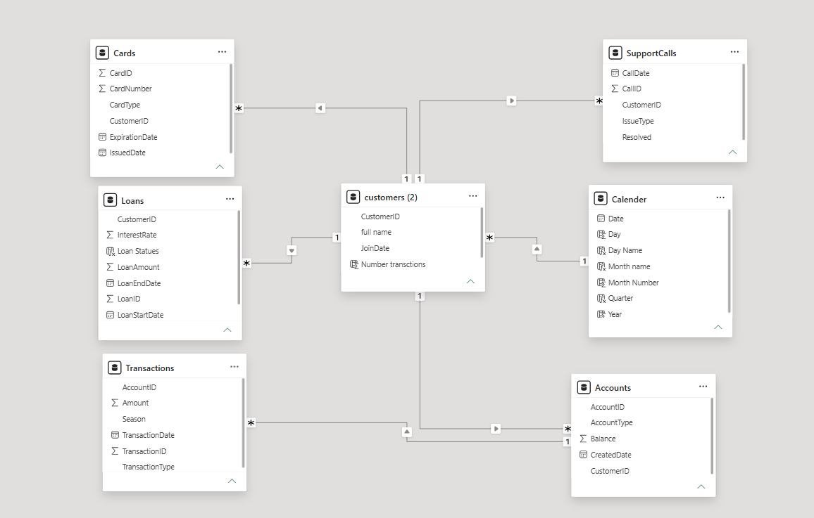
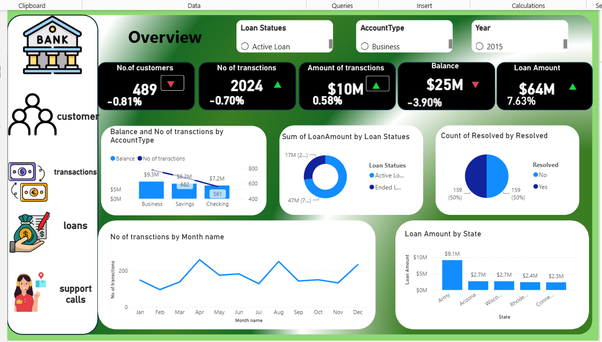
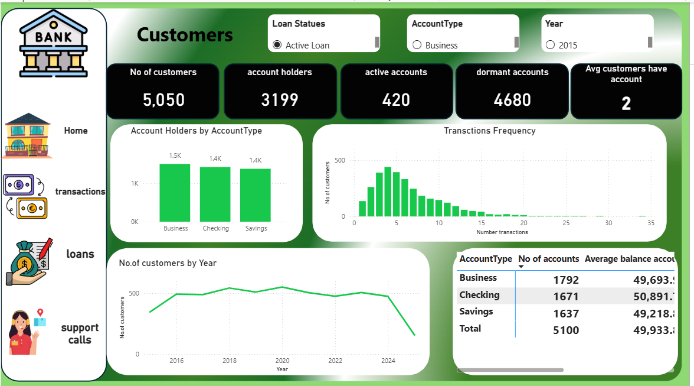
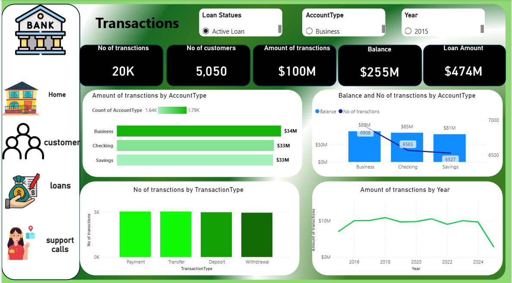
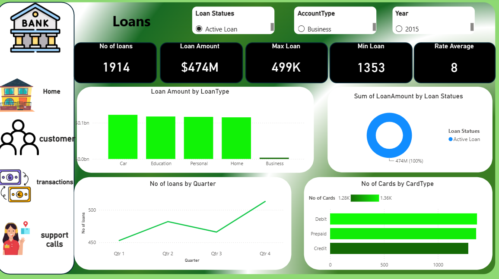
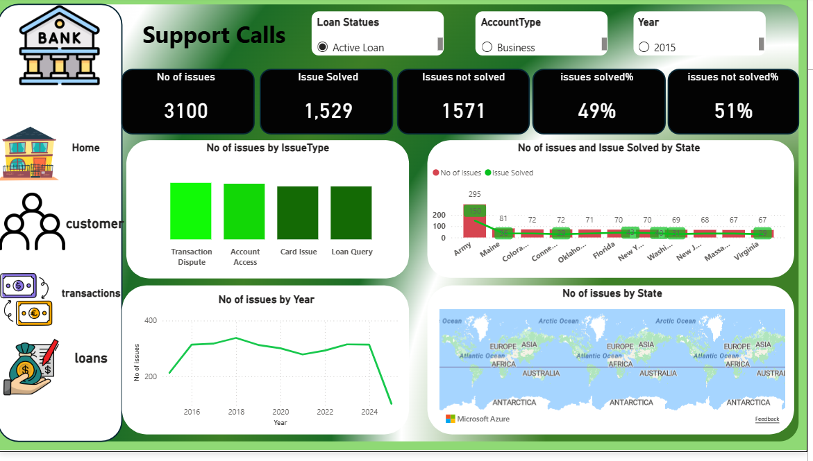
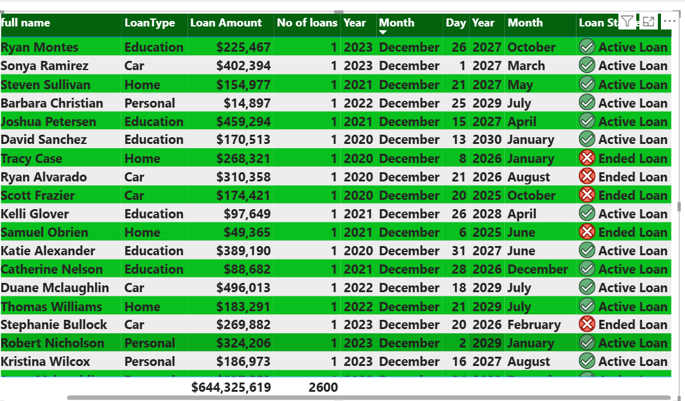

#  Banking Performance, Risk & Support Analytics (Power BI Dashboard)

##  Project Overview
An end-to-end Business Intelligence project evaluating a comprehensive banking dataset covering **5,050 customers**, **20K transactions** ($100M total value), a **$644M loan portfolio** across 2,600 loans, and **3,100 support operations**[cite: 1, 3, 4, 5]. The dashboard is structured across **5 interactive pages** to monitor financial health, customer behavior, credit risk, and operational support bottlenecks[cite: 1, 2, 3, 4, 5].

---

##  Data Modeling & Technical Execution
* **Star Schema Architecture:** Designed a relational data model connecting core transactional and operational tables (`Customers`, `Transactions`, `Loans`, `Support Calls`,'Cards','Calendar') to dedicated dimension tables.
* **Advanced DAX Measures:** Implemented custom calculated measures and filters to track active vs. ended loan distributions, account dormancy, and support resolution rates dynamically.

---

## 💡 Key Analytical Insights
1. **Portfolio & Liquidity Scale:** The bank manages **$255M** in total account balances across Checking, Savings, and Business accounts, alongside a substantial **$644M** loan portfolio (with ~70% active loans)[cite: 1].
2. **Transaction Dynamics:** Business accounts drive the largest share of transaction value (~$34M), while daily transactions remain evenly distributed across payment, transfer, deposit, and withdrawal types[cite: 3].
3. **Credit & Loan Structure:** Total loan allocation is well-balanced across Car, Personal, Home, Education, and Business sectors, backed predominantly by credit card utilization[cite: 4].
4. **Operational Bottleneck (Support Calls):** Out of **3,100 support issues** logged (spanning transaction disputes, account access, and card/loan queries), the current resolution rate stands at **49%** (with 51% unresolved), signaling a critical operational gap that requires immediate workflow optimization[cite: 5].

---

##  Strategic Business Recommendations
* **Optimize Customer Support SLAs:** Implement urgent workflow interventions for the 51% unresolved support tickets to prevent customer churn and elevate satisfaction[cite: 5].
* **Targeted Cross-Selling:** Leverage stable account balances in Checking and Savings segments to cross-sell pre-approved low-risk loans or credit products.
* **Credit Risk Monitoring:** Continuously monitor the 30% ended vs. 70% active loan distribution to proactively manage default risks across high-exposure loan categories[cite: 1, 4].

---

##  Dashboard Pages Preview

### 1. Executive Overview

### 2. Customers & Accounts Analysis

### 3. Transactions & Liquidity

### 4. Loans & Risk Portfolio

### 5. Support Calls & Operational Efficiency

### 6. Tracking Loans

---

## 📂 Project Deliverables
* **[Download Interactive Power BI Report (.pbix)](https://drive.google.com/file/d/1SODb1_NNDKbehcE546O19RAfpUpnfhVw/view?usp=sharing)** – Full source file for Power BI Desktop.
* `Banking_Analytics_Report.pdf` – High-resolution export of all 5 dashboard pages[cite: 1, 2, 3, 4, 5].
* `images/` – Clean visual exports of all dashboard views and the data model[cite: 1, 2, 3, 4, 5].
